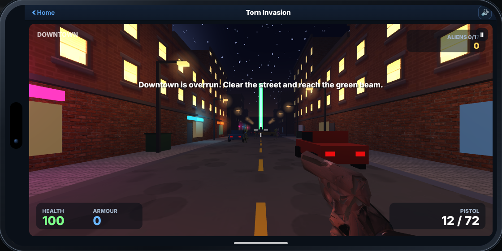
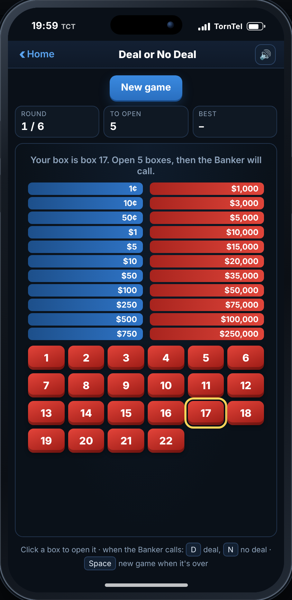
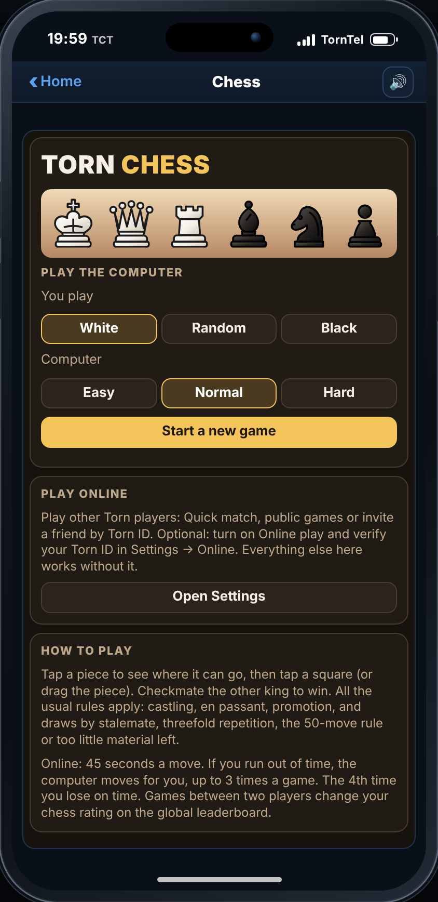
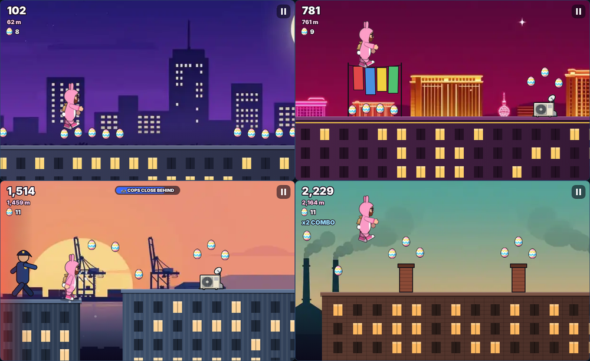
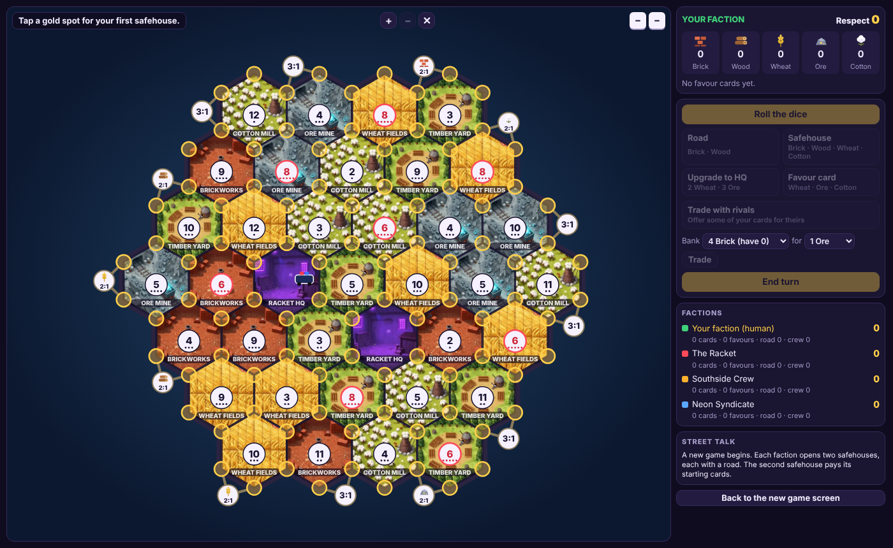

# 📱 Torn Arcade

**A phone full of games for [Torn](https://www.torn.com), by Eaglewing [571041].**

> ⚠️ **For use on Torn only.** Torn Arcade and its Art Packs are licensed solely for use on [torn.com](https://www.torn.com) through a userscript manager. Using, hosting or embedding any part of them anywhere else, or copying, modifying, redistributing or reusing them, is not allowed without written permission from the author. See [Licence](#-licence).

Torn Arcade is a Tampermonkey userscript that adds a **Mobile Phone** link to Torn's sidebar. Click it and a phone opens on top of the page with nine games, leaderboards and settings. Everything runs inside the phone, and every image, sound and piece of music is built into the script or its two optional Art Packs.

> 🧩 **2.47: Puzzle Arenas.** Each Tornies Arena now has its own puzzle (fuse boxes, bridges, a hedge maze, crates, a quiz, teleport pads and ice), and the Docks Warehouse and TornTech Factory each gain a second floor.

> 📝 **What's new:** the full update history from 2.2.0 onwards is in the [changelog](CHANGELOG.md).

> ⚔️ **2.46.3: Daily trainer rematches** in Tornies. Beaten trainers are ready again after each TCT midnight (talk to them), with much stronger teams once you're Champion.
>
> 🩹 **2.46.2:** In Tornies, a full team faint now wakes you at the last Clinic you walked into instead of back at home.
>
> 🏆 **2.46:** Leaderboards update live: Tornies sends its numbers as you play, and an open Global board refreshes itself every 30 seconds. Four new Tornies boards on the global leaderboards: **Total playtime**, **Merit points**, **Golden Tornies** and **Fish caught**. Mirabit now faces its opponent in battle.
>
> 💬 **2.45:** Torn chat stays usable while the phone is open (Settings → Torn chat over the phone). In Territories a coin toss now decides who goes first. Online Chess only rates games where both players made a move. The phone feels quicker on busy Torn pages.
>
> ⏰ **2.44: Timed reminders.** 2-minute warnings on the phone before your flight lands, you leave hospital or jail, your cooldowns end, your energy or nerve is full, your chain runs out and more, with a new **Key 2** (Custom) in Settings. Key 1 (events only) stays as it was.
>
> ⏱️ **2.43.2:** More time online: Chess gives 45 seconds a move, and in Territories every move you make (a road, a build, a trade) gives you a fresh 45 seconds.
>
> ♞ **2.43.1:** Faster online moves in Chess and Territories: on some browsers a move could wait up to 20 seconds before it was sent. It now goes out straight away.
>
> 🛡️ **2.43: Trade anti-cheat.** Tornie trades are now online only (the old send-it-yourself trade codes are gone), and the server records who owns each traded Tornie, so copies can't be traded. Settings → Cheat code is now **Redeem code**.
>
> ♞ **2.42: Chess.** Play the computer on three levels or play online with a 30 second move clock. **Public games and ⚡ Quick match** for Chess and Territories, so it's easy to find an opponent (invites by Torn ID still work). Territories' police raid has new artwork to match the Air Marshal.
>
> ✈️ **2.41: Torn Territories Flight Paths.** A new expansion played by the rules of Catan: Seafarers: fly from Torn City to islands named after Torn's travel destinations, first to 12 or 16 Respect, online too, with its own leaderboards. Classic Territories now plays to 14 Respect on the large map (the small map was retired).

> 🆕 **2.40: a fresh start.** With the new global leaderboards, every game except Tornies was reset to zero (Angry Bogies, Faction Defence, Anton's Egg Dash, Torn Territories, Dirty Bombs, Flappy Torn and Torn Invasion), so everyone starts on equal terms. **Tornies saves were not touched.** The global leaderboards were wiped the same way (Tornies boards kept). A one-time notice on the phone explains this and the new optional online service.

> 🌐 **Online play is optional.** Every game works fully on your own device, with no API key and no account. If you want to, you can turn on **Online play** (Settings → Online) to join the global leaderboards, play Torn Territories against other players and trade Tornies safely online. See [Optional online play](#-optional-online-play).

---

## ⬇️ Install

1. Install the [Tampermonkey](https://www.tampermonkey.net/) browser extension.
2. Open the install link and click **Install**:
   **[Install Torn Arcade](https://github.com/Eaglewing91/Torn-Arcade.user.js/raw/main/Torn-Arcade.user.js)**
3. Open Torn and click **Mobile Phone** under Calendar in the sidebar. On pages without the sidebar, a small floating **Phone** button appears instead.

Your progress is saved in Tampermonkey's storage on your device. Updating the script keeps your saves.

On a keyboard, **Esc** is the back button: it backs out of Tornies menus (like B) and takes you from an app to the home screen. It never closes the phone; use the **🔒 Lock** button on the home screen for that.

### 🎨 Optional Art Packs
The illustrated Tornie and character artwork comes in two separate, optional scripts. This keeps Torn Arcade itself small (about 1.6 MB), so it works on phones and apps that only accept scripts up to 2 MB. Without them, Tornies uses its pixel-art versions.

| Script | What it adds | Size | Install |
|---|---|---|---|
| **Torn Arcade - Tornies Art** | Illustrated artwork for all 179 Tornies | about 1.4 MB | [Install](https://github.com/Eaglewing91/Torn-Arcade.user.js/raw/main/Torn-Arcade-Tornies-Art.user.js) |
| **Torn Arcade - Character Art** | Illustrated portraits of the gym leaders, story characters, trainers and your outfits, plus the six Faction Defence maps, the phone theme wallpapers and the Anton's Egg Dash and Torn Territories artwork (including the Flight Paths sky, Smuggler's Dens, Air Marshal and police raid) | about 1.4 MB | [Install](https://github.com/Eaglewing91/Torn-Arcade.user.js/raw/main/Torn-Arcade-Character-Art.user.js) |

Install them like the main script, then reload Torn. The **Tornies Art** and **Character Art** apps on the bottom row of the phone show whether each pack is installed, a before/after preview, a gallery of the art you've unlocked and an on/off switch. Each pack updates itself separately.

### 👽 Torn Invasion 3D (optional add-on)
Torn Invasion is a full 3D shooter, so it comes as its own optional script and keeps Torn Arcade small.

| Script | What it adds | Size | Install |
|---|---|---|---|
| **Torn Arcade - Invasion** | Torn Invasion 3D: the 3D alien shooter that opens in the phone's Invasion app | about 1.4 MB | [Install](https://github.com/Eaglewing91/Torn-Arcade.user.js/raw/main/Torn-Arcade-Invasion.user.js) |

Install it like the main script, then reload Torn. Without it, the Invasion app shows an install button. If you played the old Torn Invasion, your kill counts, achievement progress and best scores carry over the first time it opens.

How they link: the packs hand their pictures to Torn Arcade using browser events on the Torn page you're viewing. Torn Arcade checks every picture (known names, WebP images only) before using it. The packs make **no requests of any kind**, store nothing and need no API key.

### 🔄 Automatic updates
From version 2.15.2, Tampermonkey checks this link for new versions (about once a day by default) and updates the script for you. If you installed an older version from somewhere else, reinstall once from the link above. After that, updates are automatic. This check is made by Tampermonkey to GitHub only. It isn't a request to Torn and sends no data.

---

## 📸 Screenshots

| | |
|---|---|
|  |  |
|  |  |
|  |  |
|  |  |
|  |  |
|  |  |
|  |  |
|  |  |

---

## 🎮 The games

### 🐾 Tornies
A creature-collecting RPG set in Torn City. You start in Maple Hollow with one of three partner Tornies and travel across the city to catch, train and battle **178 Tornies**, from Gutterats in the alleys to the Legendary Guardians.

- Win **8 Arena medals** from Torn City's Arena Leaders, then take on the **Torn Council** and the Champion.
- Turn-based battles with 17 types, **181 moves**, status effects, boosters and evolutions. Every type has weak, medium and strong attacks of both kinds plus status moves, and Tornies of the same type learn different moves, so no two teams fight quite alike. **37 Training Discs** teach extra moves. The **Move Coach** in every Tornie Clinic teaches a Tornie any move it's high enough level for ($500), so Tornies caught before an update can pick up the new moves.
- Day and night, live weather, fishing, a Day Care with eggs to hatch, rare golden Tornies, merits to earn and a Battle Tower.
- **Safe online trades** at any Clinic Tornie Locker (needs Online play and a verified Torn ID): offer a Tornie to a Torn ID; they get a notification on their phone and add one of theirs. You both see exactly what you'd get (species, level, stats and moves), and the swap only happens when **both** of you press Confirm. Until then the Torn Arcade server holds both Tornies like a middleman; cancel and each of you gets your own back. Each Tornie can only be collected once. **Anti-cheat:** the server records each traded Tornie and who owns it, so a Tornie copied by restoring an old save can't be traded a second time, and one Tornie can't be in two trades at once. Trades are online only, so every trade goes through the server and nobody can be short-changed.
- Custom illustrated artwork for every Tornie and character, made specifically for Torn Arcade (from the optional Art Packs; pixel art without them), plus an animated title screen and an original soundtrack.
- Illustrated towns and routes: soft shorelines, sandy beaches, snowy mountains, city streets and a neon casino strip, with swaying tall grass and lights that come on at night.
- Illustrated interiors and caves: homes, clinics, shops, gyms, the casino, offices, hospitals and labs with detailed furniture, plus rocky caves with dirt floors, pools and ice.
- Smooth maps: what is on screen is drawn during the normal fade, and the rest of the map (and the next map, as you head for an exit) is drawn only in quiet moments: battles, menus, dialogue and while you stand still. If you walk non-stop into a part that isn't ready yet, it briefly shows the classic pixel tiles instead of stuttering.
- Gift codes: the developer may send you a gift code (Tornies, items or money). Paste it into Settings → Redeem code. Each code is signed, made for one Torn ID and works once, so codes can't be faked or shared.
- Running Shoes: sold in every Tornie Supplies shop once you have three medals ($10,000). Hold B (or Shift) to run. Map options in Settings → Tornies: **Detailed maps** (off for classic pixel maps on slower phones), **Save maps on this device** (maps you have visited open instantly next time), **Prepare all maps** (a one-off that draws and saves every map, indoors and out; about 40–100 MB of browser storage and a few minutes) and **Clear saved maps**.

### 👽 Torn Invasion
A 3D first-person shooter (optional add-on, see [Install](#-install)). Aliens have taken Downtown: fight up the main street past neon shops, street lamps and crashed cars to the alien crash site and its green exit beam. Grunts rush you, Spitters fire goo, Drones hover and zap, and an armoured Brute guards the crash site. You start with a **pistol**, then find a pump-action **shotgun** and the **plasma rifle**; headshots do double damage. Drones fly over cars but not through buildings, and the Brute fires spreads of fireballs as it walks in and charges when you get close. Space jumps (handy for dodging goo and zaps). Settings for mouse speed, invert look and graphics quality (Low for older phones), a pause menu and tiered achievements. On a phone, your left thumb moves, your right thumb looks, with fire, jump, reload and swap buttons. The aliens and guns are custom illustrated 3D models made specifically for Torn Arcade, and the aliens walk, attack and fall with their own skeletons. More levels are on the way.

### 🐦 Angry Bogies
Bogie versus the Racket. Pull back the slingshot, fling Bogies (the green Slime, the Fuzz that splits into three, the hard-hitting Brawler and the explosive Bot) into the gang's hideouts, smash the structures and knock out every thug. **Fifteen levels with three stars each**, from the backstreets to Racket HQ, with more structures and more thugs as you go. Stars are scored on thugs knocked out, blocks smashed and Bogies left over.

### 🛡️ Faction Defence
A tower defence game. Racket raiders walk the roads towards your **Faction HQ**: build defenders on the spots beside the road, upgrade them with the cash you earn, and survive **30 waves** on **6 maps** (Westgate, The Docks, Midtown, Casino Strip, Industrial Zone and Racket HQ): winding roads, a crossroads, a roundabout, hairpins and maps where raiders split up and come at you from two directions. Five defenders (Gunner, Cannon, Molotov, Taser and Sniper) each have a job, and the raiders (bikers, armoured brutes and medics) make you mix them. Bosses arrive every ten waves: the **Enforcer**, the **Riot Captain** (his shield soaks up hits, but fire gets under it), and finally the **Juggernaut** in heavy bomb-suit armour that shrugs off shells and fire, with Don Varro himself on the last map. Stars depend on how much of your HQ is left. Part of what you earn goes into the **War Chest**: waves 10 and 20 are boss waves that must be cleared before the next one starts, and at the end of each your game is saved (leave any time and carry on from that point later) and you're paid what you've earned so far plus a milestone reward, and the rest at the end of the game. You spend it in the **Armoury** on new defenders, permanent upgrades and air strikes, and after wave 20 the Armoury opens mid-game, so what you buy there helps you through the last ten waves, where the Racket sends bigger, tougher crews. The War Chest belongs to Faction Defence only. The illustrated maps come with the Character Art pack; without it, simple maps are drawn instead.

### 🐰 Anton's Egg Dash
An endless rooftop runner. Anton, in his pink bunny onesie, runs across the rooftops of Torn City with a sack of Easter eggs while the police chase him, and it keeps getting faster. Jump the gaps between buildings (hold to jump higher), jump the air-conditioning units and chimneys (or land on top and run across them), and slide under the washing lines or clear them with a held jump. Painted eggs score points, **gold eggs** are worth 10 eggs, and **rotten eggs** break your combo; grab eggs in a row for up to a **x5 combo**. Slip once and the police close in; slip again before they drop back and you're caught. Police drones sweep a searchlight over the roofs: slide to hide, or the heat meter fills up and you're busted. **Carrot Bursts** make Anton fast and unstoppable for a few seconds and carry him over gaps, and the **Bunny suit** saves you from one slip or fall. When a run ends you can spend eggs on a **second chance** (25, then 50, then 100 eggs). The run passes through Downtown, the Casino Strip, the Docks and the Industrial Zone. The **double jump** unlocks after 200 eggs in total, and there are 10 achievements and Bronze, Silver, Gold and Platinum medals. Anton and the backgrounds are custom illustrated artwork made specifically for Torn Arcade and come with the Character Art pack; without it, Anton and the city are drawn by the script.

### 🏘️ Torn Territories
A district-building board game. Torn City is split into districts (Brickworks, Timber Yards, Wheat Fields, Ore Mines and Cotton Mills), each with a number. Every turn the dice are rolled and every district with that number pays out **Brick, Wood, Wheat, Ore or Cotton** to the safehouses and HQs on its corners. Spend them on **roads**, **safehouses** (1 Respect) and **HQs** (2 Respect, double pay), or on **Favour cards**: Call in the Crew, Supply Run, Street Deal, Road Crew and the secret Councillor's Favour. Roll a 7 and the **police raid** moves: big hands lose half, the raided district stops paying and the roller robs a rival there. Trade with rival factions, or with the bank and the harbours. **Longest Road** and **Biggest Crew** are worth 2 Respect each, and the first faction to **14 Respect** takes over Torn City.

Two games in one app (pick on the new game screen):

- **Play online** (optional, needs Online play and a verified Torn ID): invite up to 3 players by Torn ID, make a **public game** anyone can join from the list, or tap **⚡ Quick match** to join a waiting game (or open one). Your invite arrives as a notification on their phone; they tap it and join. A public game starts by itself when every seat is taken. The host starts when ready, and any empty seats are played by the computer. The Torn Arcade server runs the game, rolls the dice and deals the cards, so nobody can cheat, and you only ever see your own cards. Each move has a **45-second timer**, and every move you make (a road, a build, a trade) starts it again: if a player doesn't act in time (their turn, handing over cards on a 7, or answering a trade offer), the computer makes that move for them and they're back in control on their next turn. You can trade cards with the other players. Games with 2 or more people change your online rating on the global leaderboard. Classic, Flight Paths to 12 and Flight Paths to 16 each have **their own rating board**, so wins in a shorter game never count against the longer one. Flight Paths games need Torn Arcade 2.41 or newer to join.
- Play against up to three computer factions (Easy, Normal or Hard), pass-and-play with friends on one device, or watch the computer play. Rivals trade with each other, make counter-offers, and keep track of what you've collected so they won't hand you the last card for an HQ (on Hard they're strict about it).
- **Who goes first:** a coin toss at the start of every game picks the faction that places first and rolls first.
- **Classic**: Torn City as one big 37-district map, a new random board every game, first to **14 Respect**. 20 roads, 6 safehouses and 5 HQs per faction, and 5 secret Councillor's Favours in the deck (as in Catan). (The small 19-district map was retired in 2.41; a small-map game you already started still finishes with its old rules.)
- **✈️ Flight Paths** (an expansion played by the rules of Catan: Seafarers, based on its large "Heading for New Shores" board): Torn City (30 districts, two Racket HQs) sits in open sky, with four islands of 5, 5, 5 and 4 districts named after Torn's travel destinations (Mexico, Cayman Islands, Canada, Hawaii, United Kingdom, Argentina, Switzerland, Japan, China, UAE or South Africa): 49 districts in all, more than Classic's 37. Your first two safehouses go on Torn City, each with a road or a flight route.
  - **Flight routes** (Wood + Cotton) go on the sky, starting from one of your safehouses or HQs on the coast or from the end of your own flight routes. Roads and flight routes only join at your own buildings. Once a turn you can **move** the flight route at the open end of a chain (not one built that turn).
  - **Overseas Connections**: your first safehouse on each island earns **+2 Respect**.
  - **Smuggler's Dens** (3, on the islands) pay any card you choose.
  - On a small screen (phones, Torn PDA) the new game screen is one scrolling column, and the board opens zoomed in so you can scroll around it.
  - **Air Marshal**: on a 7 (or a Crew card) you can send the Air Marshal to the sky instead of the police raid. No flight routes can be built or moved next to him, and you rob a faction with a flight route there.
  - **Harbours** (11) are on Torn City only. **Longest Road** counts roads and flight routes together.
  - Choose **first to 12 or first to 16 Respect**. 15 roads, 15 flight routes, 5 safehouses and 4 HQs per faction.
- Plays by the classic Catan rules: a bank of 24 of each card with the bank-shortage rule, discard half on a 7 when holding more than 7, one favour card per turn and never on the turn you bought it. The build buttons show how many pieces you have left, and the bank trade shows how many of each card the bank holds.
- Zoom buttons and a **full screen** button for the big map. Games save as you go, so you can leave and carry on later.
- Soft background music and sound effects for building, upgrading, trading, favours and police raids, all generated live in your browser (no audio files). Music can be switched off in the game or on the new game screen.
- Your wins and fastest win for each game show in the Leaderboards app. The illustrated districts, open sky, Smuggler's Dens, Air Marshal and police raid come with the Character Art pack; without it, they're drawn by the script.

### ♞ Chess
Classic chess with a clean board, real Staunton-style pieces drawn by the script, smooth move animations, tap-or-drag moves, legal-move dots, check and last-move highlights, captured pieces and a move list.
- **Play the computer** on Easy, Normal or Hard, with Undo, Flip and your record for each level.
- **Play online** (optional): invite a player by Torn ID, make a public game anyone can join, or tap **⚡ Quick match**. Each move has a **45 second clock**; if you run out, the computer plays a move for you, up to 3 times, and after that you lose the game.
- Full rules: castling, en passant, promotion, checkmate, stalemate, threefold repetition, the 50-move rule and insufficient material. Online games between two players count towards a Chess rating on the global leaderboards (a game only counts once both players have made a move; games against the computer stay on your device).

### 💣 Dirty Bombs
A minesweeper-style puzzle. Clear the city block by block without setting off a dirty bomb. Numbers show how many bombs are hidden next to each block.

### 🐤 Flappy Torn
Tap to fly through the gaps in the pipes over the Torn City skyline. Every pipe you pass is a point. One difficulty for everyone (Hard), so every score counts on the same leaderboard.

### 🏆 Leaderboards and ⚙️ Settings
**Leaderboards** has two tabs. **My scores** keeps your best result for every game on this device and works offline. **🌐 Global** (optional, needs Online play) ranks you against every verified player: pick a game, then a mode or map (Dirty Bombs by difficulty, Faction Defence by map, Tornies by Tornies caught, Arena medals, Total playtime, Merit points, Golden Tornies or Fish caught, Torn Territories by online rating: Classic, Flight Paths 12 and Flight Paths 16), and see the top 50 as a table of rank, name, Torn ID (tap it to open their Torn profile) and score, plus your own rank. Settings has sound and volume, **phone themes** (Classic, Neon Night, Crimson Syndicate, Casino Royale, Emerald Jungle and the light Riviera, each with its own colours, clock and icon style; the illustrated theme wallpapers come with the Character Art pack, and without it a matching gradient is used), wallpapers for the Classic theme, optional Torn event notifications, a Tornies cheat-code box and options to reset each game's data.

---

## ✅ Torn rules

Torn Arcade is built to follow Torn's scripting rules:

- Apart from adding the **Mobile Phone** link to the sidebar, it never reads, clicks or changes anything on Torn's page. The one exception is optional: while the phone is open, **Torn chat over the phone** (Settings, on by default) lifts Torn's own chat bar and chat windows above the phone so you can keep chatting. That's a display change only; nothing is clicked or sent.
- It **never loads Torn pages** and makes **no non-API requests** to Torn.
- It doesn't talk to any website other than the official Torn API (only if you add a key for event notifications or reminders) and, only if you turn on the optional **Online play**, the Torn Arcade server (see below). The Art Pack install buttons are plain links to this GitHub page that only open when you tap them.
- It uses **no websockets**.
- The optional Art Packs make no requests at all. They only pass pictures to Torn Arcade on the page.
- The optional **Torn Arcade - Invasion** script makes no requests at all. It only draws the game inside the phone and talks to Torn Arcade through events on the page.
- Games only react to keys while the phone is open, and never while you're typing in a text box.
- **No game needs an API key or Online play.** Both are optional extras.

### 🗝️ Which API key for what
No game needs a key. A key only adds notifications on the phone, and only while the phone is open. Settings → Notifications offers **two Custom keys**, compared side by side in a table (what each one gives you, its exact selections and its own Generate button); pick one. Each **Generate** button opens Torn's own new-key page in a new tab with exactly these selections ticked; you confirm it on Torn and paste the key back. A custom key can't read anything outside its selections (no money, messages, items or battle stats).

| Key | Selections (Custom key) | Torn access level of each | What you get |
|---|---|---|---|
| **Key 1 · Events only** | `user → basic, events` | basic: Public · events: Limited | Your new Torn events on the phone |
| **Key 2 · Events + reminders** | `user → basic, events, travel, cooldowns, bars, refills, organizedcrime` | basic: Public · events: Limited · travel, cooldowns, bars, refills, organizedcrime: Minimal | Everything in key 1, plus the timed reminders below |
| Online play (optional) | **Public** `user → basic` (or your saved key 1 or 2) | Public | Your name and Torn ID, sent once to the Torn Arcade server, which asks `api.torn.com` who owns it and forgets it |

You can verify for Online play with your saved key (**Use my saved key**); only your name and Torn ID are read. If you'd rather not send it, make a separate Public key and paste that instead.

**What each selection is used for (key 2):**

| Selection | Used for |
|---|---|
| `basic` | Your status: the time you leave **hospital** or **jail** |
| `events` | Your new Torn **events** |
| `travel` | Your **flight**: destination and landing time |
| `cooldowns` | When your **drug**, **booster** and **medical** cooldowns end |
| `bars` | When your **energy** and **nerve** will be full, and your **faction chain** timeout |
| `refills` | Whether your energy and nerve **refills** are still unused today |
| `organizedcrime` | When your **organised crime** is ready |

### Optional event notifications
With key 1 or key 2 saved, the phone checks the official Torn API (`api.torn.com`, `/v2/user/events`) for new events **every 5 seconds while the phone is open**. That's 12 calls a minute, well under Torn's limit of 100. Nothing is requested while the phone is closed. The key is only ever sent to `api.torn.com`. If Torn's newer API ever refuses a custom key for events, Torn Arcade asks the older API path for the same events instead (still only `api.torn.com`). See the Torn API terms on Torn's API page (on [Torn](https://www.torn.com), under the API section).

### ⏰ Optional timed reminders (key 2)
While the phone is open, the phone shows a warning **2 minutes** before:
- ✈️ your flight lands (there and back), and again when you've landed
- 🏥 you leave hospital, 🚔 you leave jail
- 💊 your drug, 🍬 booster or 🩹 medical cooldown ends
- ⚡ your energy or 💪 nerve will be full
- ⛓️ your faction chain runs out (when a chain of 10+ is running)
- 🔁 the new Torn day starts while your energy or nerve refill is unused (10 minutes before)
- 🕵️ your organised crime is ready
- 🌙 the new Torn day starts

How it works: **once a minute while the phone is open**, one request to `api.torn.com` (`/v2/user?selections=basic,travel,cooldowns,bars,refills,organizedcrime`) reads the times; the phone counts down by itself in between. The answers are only shown, never saved or sent anywhere. Turn them all on or off with one switch (Settings → Notifications → Timed reminders). With key 1, only the hospital, jail and new-day reminders work; the key table in Settings shows what each key covers.

### 🌐 Optional online play
**Online play is completely optional and off until you turn it on** (Settings → Online). **Every game works fully without it**: Tornies, Torn Invasion, Angry Bogies, Faction Defence, Egg Dash, Torn Territories against the computer or pass-and-play, Chess against the computer, Dirty Bombs and Flappy Torn all play on your own device, with no API key, no account and no server. Online play only *adds* four things:

1. **Global leaderboards** in the Leaderboards app (your best scores against every verified player).
2. **Online Torn Territories and Chess**: games against other players. Invite by Torn ID, make a public game anyone can join, or use **Quick match**.
3. **Safe online Tornie trades** at any Clinic Tornie Locker.
4. **Cloud saves** (a separate switch): the same progress on your phone and PC.

**Who and where.** While Online play is on, the phone talks to the **Torn Arcade server** (`arcade-server-production-8ebd.up.railway.app`), run by Eaglewing [571041] and hosted on Railway. The address is declared in the script header with `@connect`, and it is the only website Online play talks to. Requests are plain HTTPS through Tampermonkey (`GM_xmlhttpRequest`); **no websockets**. The server's code is public in the [`server`](server) folder.

**Signing in.**
- **Verify your Torn ID** (needed for leaderboards, online games and trades) with **Use my saved key** or a pasted **Public** key. The key is sent to the Torn Arcade server **once**; the server asks `api.torn.com` who owns it (`/v2/user/basic`: your name and Torn ID only) and then forgets it. **The key is never stored or logged on the server.** You get a sign-in token, which the server keeps only as a one-way fingerprint.
- **Or play as a guest**, with no key at all. Guests can switch Online play on, but don't appear on the leaderboards and can't be invited to games or trades until they verify.

**What is sent, and when.** Only while Online play is on:
- **When you tap something:** verifying, playing as a guest, signing out, deleting your online account, opening the Global tab of Leaderboards, creating, joining, starting or leaving an online game, your moves in an online game, and every step of an online trade.
- **Your best scores** (verified players only): right after you verify, when you open the Global tab, and when you set a new best. Your Tornies numbers (caught, medals, merits, golden Tornies, fish and playtime) go as they change while you play; playtime at most every 5 minutes, and when you leave Tornies.
- **Live leaderboards:** while a Global leaderboard is on screen, that board is refreshed **every 30 seconds**.
- **Notifications:** while the phone is open, it asks the server **every 20 seconds** for game invites, online games waiting on you and trades waiting on you, and shows new ones as a notification on the phone.
- **Live online games:** while an online game is on screen, the phone asks the server for news and the server answers as soon as something changes (long polling, at most one request every 20 seconds while nothing happens). While an online lobby screen is open (Territories or Chess), the game lists are checked every 5 seconds.

With Online play off, **nothing** is ever sent, and nothing is requested while the phone is closed.

**Cloud saves** (Settings → Online → Cloud saves; off until you turn it on; verified players only). Your game progress is kept on the server so it's the same on every device you play on: **Tornies** (with the trade and gift codes you've used, so they can't be used twice), **Faction Defence**, **Egg Dash**, **Angry Bogies**, your **best scores** and a **Torn Territories game in progress**. Settings, theme and saved maps stay on each device, and Torn Invasion (a separate script) isn't included yet.
- About 15 seconds after a game saves, and when you lock the phone, the change is sent. When you open the phone, newer saves from your other devices are fetched first.
- If two devices both made progress on the same game before syncing, the phone shows both (for Tornies: name, medals, Tornies caught and play time) and asks which to keep. Nothing is overwritten silently, and an older save can never replace a newer one by accident.
- Up to 512 KB per game and 2 MB in total per player. **Delete my cloud saves** removes them from the server without touching the saves on your device.

**What the server keeps** (until you delete your online account): your Torn ID and name, your best scores and online rating, records of online games you play (moves, results), Tornie trades you take part in (each Tornie as a trade code) until both sides have collected, and your cloud saves if you turn them on. Open trades nobody finishes are cancelled after 3 days. **Trade anti-cheat records** (each traded Tornie's ID, species, level, stats and its owner's Torn ID, refused trade attempts and trade bans) are kept even after an account is deleted, so a ban or a copied Tornie can't be cleared by deleting and re-creating an account; the developer (Eaglewing) can see the trade log to deal with cheating. **Settings → Online → Delete my online account** deletes your account, sign-ins, scores, ratings and cloud saves, and hands your seats in any running online games to the computer.

**Fair play.** Online Territories and Chess games are run on the server with the same rules engines as the phone, so dice, cards and moves can't be faked, and you only ever see your own cards. Best scores for the other games come from players' own devices, so the server can't watch you play them; it rejects impossible values (for example wave 41 in Faction Defence, or more than 179 Tornies).

---

## 📄 Terms of Service

| Data Storage | Data Sharing | Purpose of Use | Key Storage & Sharing | Key Access Level |
|---|---|---|---|---|
| Only locally | Nobody | Public amusement (games), event notifications and timed reminders on the phone | Stored locally / Used only for automation (event and reminder checks while the phone is open). Never shared. | Custom, one of two (optional): **Key 1** user → basic, events · **Key 2** user → basic, events, travel, cooldowns, bars, refills, organizedcrime Optional: only needed for event notifications |

- **Data Storage:** settings, theme, wallpaper, best scores, your Tornies save, Torn Invasion progress, Angry Bogies stars, Faction Defence progress (stars, War Chest and Armoury), Egg Dash eggs and achievements, a Torn Territories game in progress and your API key are kept in Tampermonkey storage on your device. Events are shown on the phone but never saved. With **Save maps on this device** on (Settings → Tornies), pictures of the Tornies maps the game has drawn are also kept in your browser's own storage for torn.com (IndexedDB, `torn-arcade-maps`). They are drawn by the script on your device, contain no personal data, are never uploaded or shared, and **Clear saved maps** deletes them.
- **Data Sharing:** nothing is sent anywhere except event requests to `api.torn.com` and, only if you turn on Online play, requests to the Torn Arcade server (see below).
- **Where it may be used:** Torn (torn.com) only. See [Licence](#-licence).
- The same table is shown next to the API key box in Settings and at the top of the script.

**Online play** (optional, off by default; no game needs it):

| Data Storage | Data Sharing | Purpose of Use | Key Storage & Sharing | Key Access Level |
|---|---|---|---|---|
| Persistent - until account deletion (on the Torn Arcade server: your Torn ID, name, best scores, online rating, online game records, Tornie trades and, if you turn them on, cloud saves of your game progress; on your device: a sign-in token). Persistent - forever for trade anti-cheat records (Tornie IDs and owners' Torn IDs, refused trade attempts and trade bans) | General public (your name, Torn ID, rating and best scores on the global leaderboards); the players in your online games and trades see your name, Torn ID, your moves, and the Tornie you offer; the service owner sees trade records for anti-cheat | Public community tools (global leaderboards, online Torn Territories and Chess games and Tornie trades, with trade anti-cheat) | Not stored / Not shared (sent once to the Torn Arcade server to confirm your Torn ID with `api.torn.com`, then forgotten) | Public (user → basic). The custom key (user → basic, events) or a Limited key also works; only your name and Torn ID are read |

The same table is shown in Settings → Online wherever you can enter a key, and at the top of the script. The server is hosted on Railway ([Railway privacy policy](https://railway.com/legal/privacy)); see also the Torn API terms on Torn's API page.

**Torn Arcade - Invasion:**

| Data Storage | Data Sharing | Purpose of Use | Key Storage & Sharing | Key Access Level |
|---|---|---|---|---|
| Only locally (settings, best scores and achievement progress) | Nobody | Public amusement (Torn Invasion 3D) | Not stored / Not shared (no key used) | None (no API key needed) |

**Art Packs** (Tornies Art and Character Art):

| Data Storage | Data Sharing | Purpose of Use | Key Storage & Sharing | Key Access Level |
|---|---|---|---|---|
| No | Nobody | Public amusement (artwork for the Torn Arcade games) | Not stored / Not shared (no key used) | None (no API key needed) |

---

## 📝 Licence

**All rights reserved. For use on Torn only.**

- ✅ **You may:** install Torn Arcade and its Art Packs from the official links on this page, use them **on Torn (torn.com)** for your own personal play, and read the code to check that it's safe and follows Torn's rules.
- ❌ **You may not** (without the author's written permission), for the author's own work:
  - use them, or any part of them, **anywhere other than Torn**: other websites, apps, games, servers, emulators, launchers, app stores or standalone software;
  - copy, republish, modify, adapt or make derivative works from them;
  - redistribute, share, sell, sublicense or host them anywhere else, including other script sites, gists, repositories or file shares;
  - extract or reuse their code, artwork, characters, music or other content in other projects or media, including to train AI models;
  - use them commercially, or remove the licence notice.
- Permission is personal, limited to Torn, and ends automatically if these terms are broken.

**Torn's own material isn't claimed.** The licence covers only the author's own work: the code, the games, the original characters and creatures (including the Tornies), the artwork, the music and the original text. Torn, Torn City, and Torn's names, places, items and characters belong to Torn's owners. They appear only as fan references, inside scripts made solely for use on Torn, and no rights are claimed over them. Player usernames belong to those players. Anything will be removed or changed on request from Torn's staff or the player.

See [LICENSE](LICENSE) for the full terms. The same licence is at the top of every script.

Torn Arcade is an unofficial fan project. It isn't affiliated with, endorsed by or sponsored by Torn or its owners.

---

Made by **Eaglewing [571041]**.
