# 📱 Torn Arcade

**A phone full of games for [Torn](https://www.torn.com), by Eaglewing [571041].**

> ⚠️ **For use on Torn only.** Torn Arcade and its Art Packs are licensed solely for use on [torn.com](https://www.torn.com) through a userscript manager. Using, hosting or embedding any part of them anywhere else, or copying, modifying, redistributing or reusing them, is not allowed without written permission from the author. See [Licence](#-licence).

Torn Arcade is a Tampermonkey userscript that adds a **Mobile Phone** link to Torn's sidebar. Click it and a phone opens on top of the page with six games, a scores screen and settings. Everything runs inside the phone, and every image, sound and piece of music is built into the script or its two optional Art Packs.

---

## ⬇️ Install

1. Install the [Tampermonkey](https://www.tampermonkey.net/) browser extension.
2. Open the install link and click **Install**:
   **[Install Torn Arcade](https://github.com/Eaglewing91/Torn-Arcade.user.js/raw/main/Torn-Arcade.user.js)**
3. Open Torn and click **Mobile Phone** under Calendar in the sidebar. On pages without the sidebar, a small floating **Phone** button appears instead.

Your progress is saved in Tampermonkey's storage on your device. Updating the script keeps your saves.

### 🎨 Optional Art Packs
The illustrated Tornie and character artwork comes in two separate, optional scripts. This keeps Torn Arcade itself small (about 1.4 MB), so it works on phones and apps that only accept scripts up to 2 MB. Without them, Tornies uses its pixel-art versions.

| Script | What it adds | Size | Install |
|---|---|---|---|
| **Torn Arcade - Tornies Art** | Illustrated artwork for all 179 Tornies | about 1.4 MB | [Install](https://github.com/Eaglewing91/Torn-Arcade.user.js/raw/main/Torn-Arcade-Tornies-Art.user.js) |
| **Torn Arcade - Character Art** | Illustrated portraits of the gym leaders, story characters, trainers and your outfits, plus the six Faction Defence maps and the phone theme wallpapers | about 1.1 MB | [Install](https://github.com/Eaglewing91/Torn-Arcade.user.js/raw/main/Torn-Arcade-Character-Art.user.js) |

Install them like the main script, then reload Torn. The **Tornies Art** and **Character Art** apps on the bottom row of the phone show whether each pack is installed, a before/after preview, a gallery of the art you've unlocked and an on/off switch. Each pack updates itself separately.

How they link: the packs hand their pictures to Torn Arcade using browser events on the Torn page you're viewing. Torn Arcade checks every picture (known names, WebP images only) before using it. The packs make **no requests of any kind**, store nothing and need no API key.

### 🔄 Automatic updates
From version 2.15.2, Tampermonkey checks this link for new versions (about once a day by default) and updates the script for you. If you installed an older version from somewhere else, reinstall once from the link above. After that, updates are automatic. This check is made by Tampermonkey to GitHub only. It isn't a request to Torn and sends no data.

---

## 📸 Screenshots

| | |
|---|---|
| 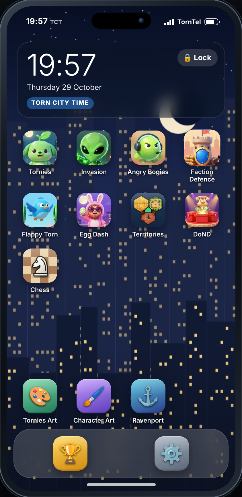 | 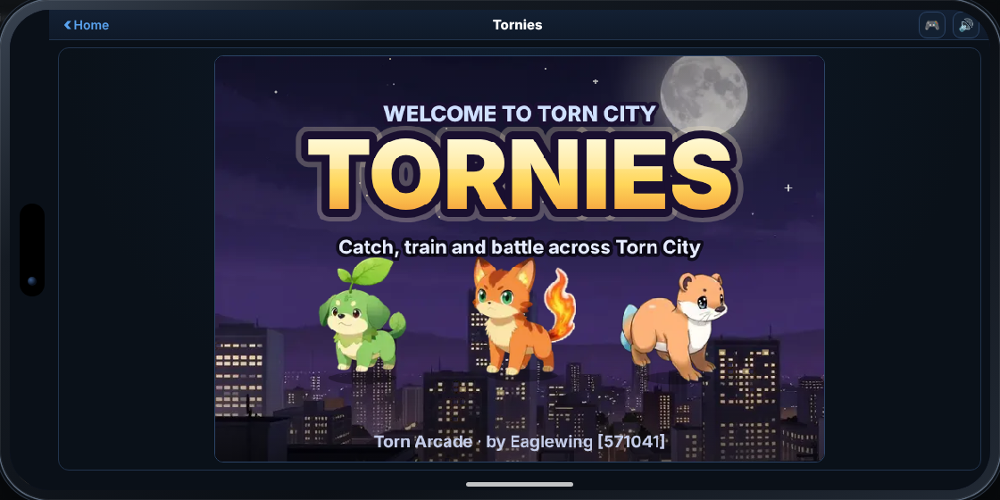 |
| 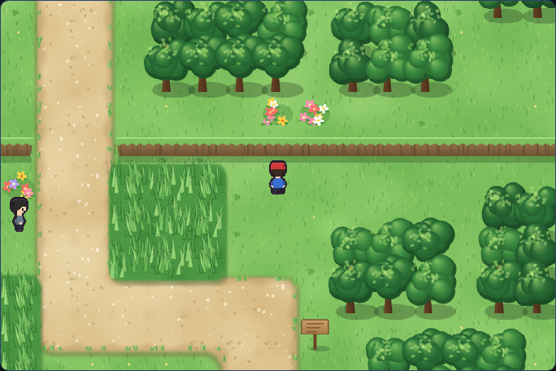 | 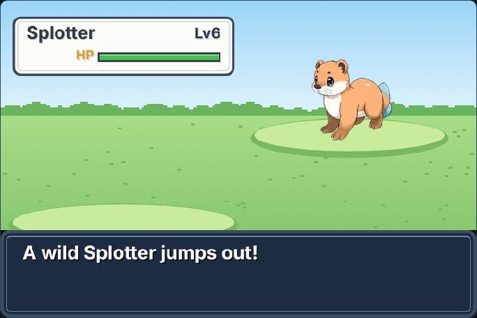 |
| 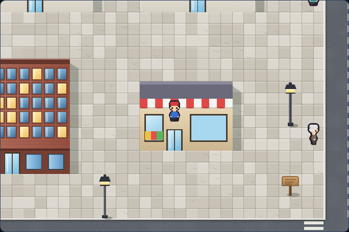 | 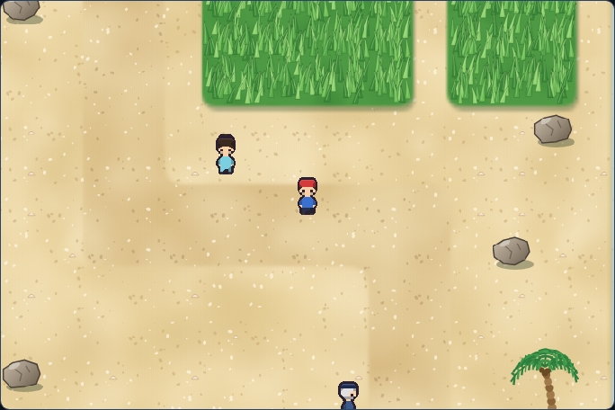 |
| 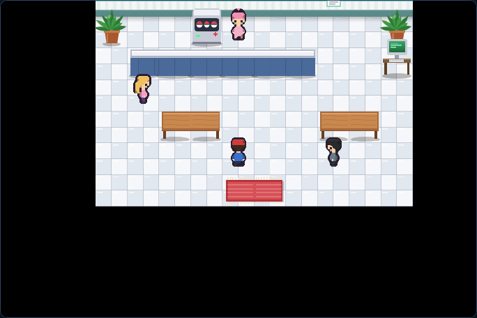 | 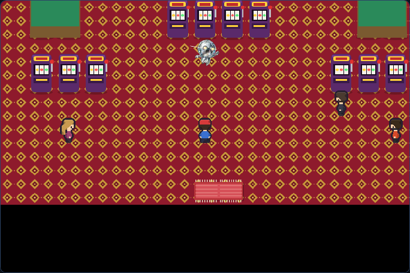 |
| 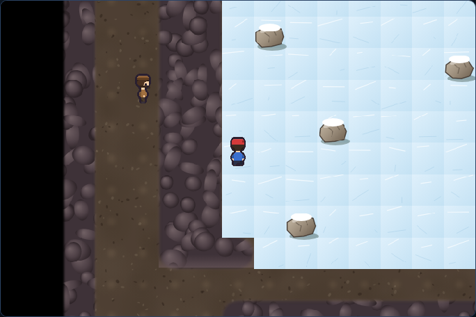 | 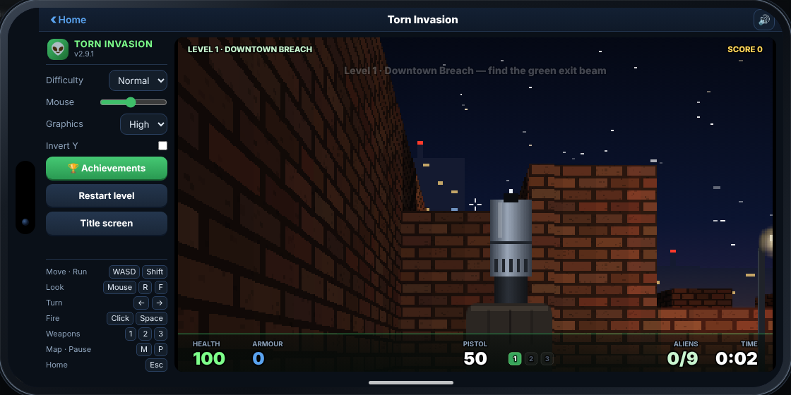 |
| 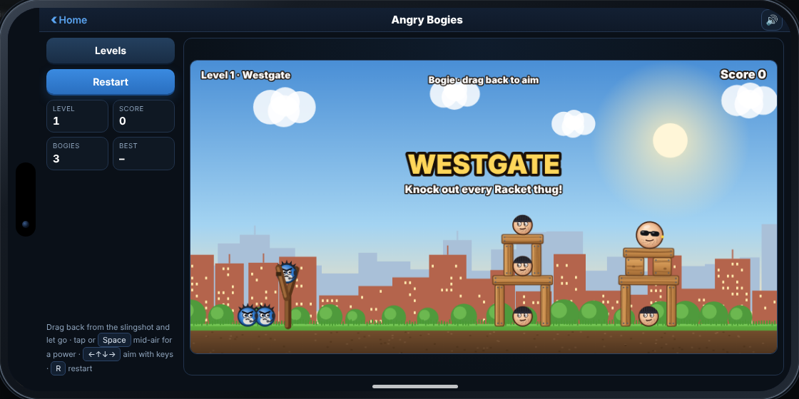 | 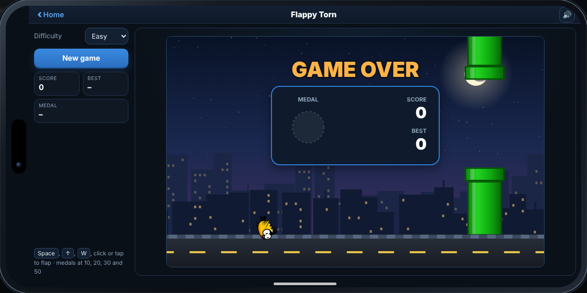 |
| 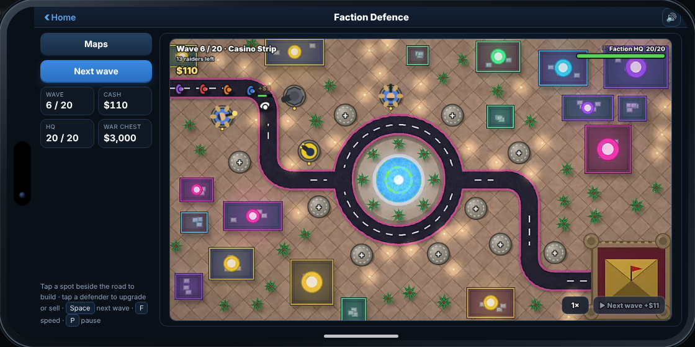 | 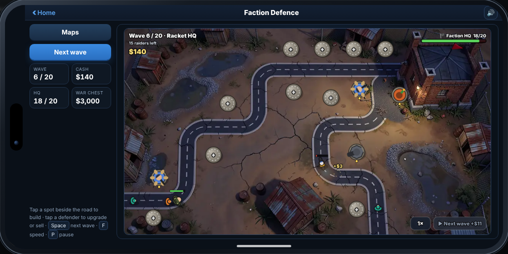 |

---

## 🎮 The games

### 🐾 Tornies
A creature-collecting RPG set in Torn City. You start in Maple Hollow with one of three partner Tornies and travel across the city to catch, train and battle **178 Tornies**, from Gutterats in the alleys to the Legendary Guardians.

- Win **8 Arena medals** from Torn City's Arena Leaders, then take on the **Torn Council** and the Champion.
- Turn-based battles with 17 types, status effects, boosters and evolutions.
- Day and night, live weather, fishing, a Day Care with eggs to hatch, rare golden Tornies, merits to earn and a Battle Tower.
- Trade Tornies with friends using trade codes. No server is involved.
- Custom illustrated artwork for every Tornie and character, made specifically for Torn Arcade (from the optional Art Packs; pixel art without them), plus an animated title screen and an original soundtrack.
- Illustrated towns and routes: soft shorelines, sandy beaches, snowy mountains, city streets and a neon casino strip, with swaying tall grass and lights that come on at night.
- Illustrated interiors and caves: homes, clinics, shops, gyms, the casino, offices, hospitals and labs with detailed furniture, plus rocky caves with dirt floors, pools and ice.
- Smooth maps: what is on screen is drawn during the normal fade, and the rest of the map (and the next map, as you head for an exit) is drawn only in quiet moments: battles, menus, dialogue and while you stand still. If you walk non-stop into a part that isn't ready yet, it briefly shows the classic pixel tiles instead of stuttering.
- Gift codes: the developer may send you a gift code (Tornies, items or money). Paste it into Settings → Cheat code. Each code is signed, made for one Torn ID and works once, so codes can't be faked or shared.
- Running Shoes: sold in every Tornie Supplies shop once you have three medals ($10,000). Hold B (or Shift) to run. Map options in Settings → Tornies: **Detailed maps** (off for classic pixel maps on slower phones), **Save maps on this device** (maps you have visited open instantly next time), **Prepare all maps** (a one-off that draws and saves every map, indoors and out; about 40–100 MB of browser storage and a few minutes) and **Clear saved maps**.

### 👽 Torn Invasion
A Doom-style first-person shooter. Aliens have overrun Torn City, and you fight through infested levels with a **pistol, shotgun and plasma rifle**. Unlock levels as you clear them, beat your best times and scores, and collect achievements.

### 🐦 Angry Bogies
Bogie versus the Racket. Pull back the slingshot, fling Bogies into the gang's hideouts, smash the structures and knock out every thug. **Fifteen levels with three stars each**, from the backstreets to Racket HQ, with more structures and more thugs as you go. Stars are scored on thugs knocked out, blocks smashed and Bogies left over.

### 🛡️ Faction Defence
A tower defence game. Racket raiders walk the roads towards your **Faction HQ**: build defenders on the spots beside the road, upgrade them with the cash you earn, and survive **40 waves** on **6 maps** (Westgate, The Docks, Midtown, Casino Strip, Industrial Zone and Racket HQ): winding roads, a crossroads, a roundabout, hairpins and maps where raiders split up and come at you from two directions. Five defenders (Gunner, Cannon, Molotov, Taser and Sniper) each have a job, and the raiders (bikers, armoured brutes and medics) make you mix them. Bosses arrive every ten waves: the **Enforcer**, the **Riot Captain** (his shield soaks up hits, but fire gets under it), both together, and finally the **Juggernaut** in heavy bomb-suit armour that shrugs off shells and fire, with Don Varro himself on the last map. Stars depend on how much of your HQ is left. Part of what you earn goes into the **War Chest**: waves 10, 20 and 30 are boss waves that must be cleared before the next one starts, and at the end of each you're paid what you've earned so far plus a milestone reward, and the rest at the end of the game. You spend it in the **Armoury** on new defenders, permanent upgrades and air strikes, and after wave 30 the Armoury opens mid-game, so what you buy there helps you through the last ten waves. The War Chest belongs to Faction Defence only. The illustrated maps come with the Character Art pack; without it, simple maps are drawn instead.

### 💣 Dirty Bombs
A minesweeper-style puzzle. Clear the city block by block without setting off a dirty bomb. Numbers show how many bombs are hidden next to each block.

### 🐤 Flappy Torn
Tap to fly through the gaps in the pipes over the Torn City skyline. Every pipe you pass is a point.

### 🏆 Scores and ⚙️ Settings
Scores keeps your best result for every mini-game. Settings has sound and volume, **phone themes** (Classic, Neon Night, Crimson Syndicate, Casino Royale, Emerald Jungle and the light Riviera, each with its own colours, clock and icon style; the illustrated theme wallpapers come with the Character Art pack, and without it a matching gradient is used), wallpapers for the Classic theme, optional Torn event notifications, a Tornies cheat-code box and options to reset each game's data.

---

## ✅ Torn rules

Torn Arcade is built to follow Torn's scripting rules:

- Apart from adding the **Mobile Phone** link to the sidebar, it never reads, clicks or changes anything on Torn's page.
- It **never loads Torn pages** and makes **no non-API requests** to Torn.
- It doesn't talk to any website other than the official Torn API, and only does that if you turn on event notifications. The Art Pack install buttons are plain links to this GitHub page that only open when you tap them.
- The optional Art Packs make no requests at all. They only pass pictures to Torn Arcade on the page.
- Games only react to keys while the phone is open, and never while you're typing in a text box.

### Optional event notifications
If you add a **Limited** access API key in Settings, the phone checks the official Torn API (`api.torn.com`, `/v2/user/events`) for new events **every 5 seconds while the phone is open**. That's 12 calls a minute, well under Torn's limit of 100. Nothing is requested while the phone is closed. The key is only ever sent to `api.torn.com`. See the Torn API terms on Torn's API page (on [Torn](https://www.torn.com), under the API section).

---

## 📄 Terms of Service

| Data Storage | Data Sharing | Purpose of Use | Key Storage & Sharing | Key Access Level |
|---|---|---|---|---|
| Only locally | Nobody | Public amusement (games) and event notifications on the phone | Stored locally / Used only for automation (event checks while the phone is open). Never shared. | Limited (user → events). Optional: only needed for event notifications |

- **Data Storage:** settings, theme, wallpaper, best scores, your Tornies save, Torn Invasion progress, Angry Bogies stars, Faction Defence progress (stars, War Chest and Armoury) and your API key are kept in Tampermonkey storage on your device. Events are shown on the phone but never saved. With **Save maps on this device** on (Settings → Tornies), pictures of the Tornies maps the game has drawn are also kept in your browser's own storage for torn.com (IndexedDB, `torn-arcade-maps`). They are drawn by the script on your device, contain no personal data, are never uploaded or shared, and **Clear saved maps** deletes them.
- **Data Sharing:** nothing is sent anywhere except event requests to `api.torn.com`.
- **Where it may be used:** Torn (torn.com) only. See [Licence](#-licence).
- The same table is shown next to the API key box in Settings and at the top of the script.

**Art Packs** (Tornies Art and Character Art):

| Data Storage | Data Sharing | Purpose of Use | Key Storage & Sharing | Key Access Level |
|---|---|---|---|---|
| No | Nobody | Public amusement (artwork for the Torn Arcade games) | Not stored / Not shared (no key used) | None (no API key needed) |

---

## 📝 Licence

**All rights reserved. For use on Torn only.**

- ✅ **You may:** install Torn Arcade and its Art Packs from the official links on this page, use them **on Torn (torn.com)** for your own personal play, and read the code to check that it's safe and follows Torn's rules.
- ❌ **You may not** (without the author's written permission), for the author's own work:
  - use them, or any part of them, **anywhere other than Torn**: other websites, apps, games, servers, emulators, launchers, app stores or standalone software;
  - copy, republish, modify, adapt or make derivative works from them;
  - redistribute, share, sell, sublicense or host them anywhere else, including other script sites, gists, repositories or file shares;
  - extract or reuse their code, artwork, characters, music or other content in other projects or media, including to train AI models;
  - use them commercially, or remove the licence notice.
- Permission is personal, limited to Torn, and ends automatically if these terms are broken.

**Torn's own material isn't claimed.** The licence covers only the author's own work: the code, the games, the original characters and creatures (including the Tornies), the artwork, the music and the original text. Torn, Torn City, and Torn's names, places, items and characters belong to Torn's owners. They appear only as fan references, inside scripts made solely for use on Torn, and no rights are claimed over them. Player usernames belong to those players. Anything will be removed or changed on request from Torn's staff or the player.

See [LICENSE](LICENSE) for the full terms. The same licence is at the top of every script.

Torn Arcade is an unofficial fan project. It isn't affiliated with, endorsed by or sponsored by Torn or its owners.

---

Made by **Eaglewing [571041]**.
